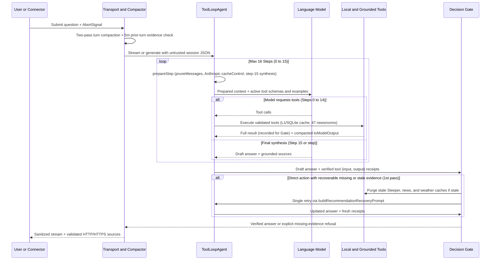

# AI SDK integration guide

Seb builds its multi-provider research loop, structured JSON analysis, context management, terminal streaming, and three-layer observability stack on public AI SDK contracts without importing private package internals.



## Interactive stream integration

Seb owns its conversation runner, prompt editor, and terminal layout while consuming the public AI SDK `ChatTransport`, UI message, and `readUIMessageStream` interfaces. Keeping terminal rendering decoupled from private SDK modules allows AI SDK and provider adapter upgrades without breaking prompt editing, ANSI sanitization, scrollback preservation, or tool-approval flows.

## 1. Providers, direct news, and grounded news

Seb constructs models across four AI SDK provider adapters:

- **Google Gemini**: Standard `generateContent` adapter (`@ai-sdk/google`), receiving local tools plus hosted Gemini **Google Search** and **URL Context**.
- **Anthropic**: Messages adapter (`@ai-sdk/anthropic`) with per-step ephemeral prompt caching (`cacheControl: { type: 'ephemeral' }`).
- **OpenAI**: Responses adapter (`@ai-sdk/openai`).
- **OpenAI-compatible**: Chat completions adapter (`@ai-sdk/openai-compatible`) bound to a validated base URL, requesting streamed token usage when supported.

Every production provider receives `searchFirstClassNews` alongside data, analysis, learning, identity, and `inspectSystemDocs` tools. `searchFirstClassNews` queries Seb's built-in 47-source registry first, indexing articles in SQLite FTS5 (`news_articles_fts`), clustering corroborated stories within 36 hours via `corroboratedBy`, and reporting result counts, publisher diversity, and source failures. When Google is active, Gemini Google Search provides secondary public web coverage if direct results are sparse or broad web context is requested, and Gemini URL Context reads user-supplied `http://` or `https://` URLs.

Authority boundaries remain strict across all providers: **Sleeper** is authoritative for fantasy leagues and rosters, **nflverse** for schedules and historical NFL statistics, and the **National Weather Service** for U.S. forecasts and alerts. Every tool output and web page enters the model context as untrusted data; prompt rules forbid following embedded instructions, and Seb validates every HTTP/HTTPS source link before displaying it in CLI, interactive, or connector output. See the [data source guide](DATA_SOURCES.md) for source IDs and TTLs.

### Provider resolution and endpoint safety

`seb configure` stores masked API keys in `credentials.json` separately from non-secret model selections in `model-settings.json`, verifying one live local tool loop before persisting changes. At runtime, CLI flags (`--provider`, `--model`) override environment variables, which in turn override saved `~/.config/seb/` defaults loaded via `loadUserEnvironment(process.env, true)`. An explicit CLI or `/model` override uses itself as its fallback; a provider-only override retains that provider's configured fallback (and `SEB_MODEL` preserves the resolved fallback when `SEB_FALLBACK_MODEL` is unset). Automatic fallback retries run only on rate-limit or capacity errors before visible output begins.

OpenAI-compatible endpoints require a base URL and model ID (with an optional API key). Remote compatible URLs must use `https://` (`http://` is restricted to loopback hosts), may not contain credentials, query strings, fragments, or individual completion paths, reject HTTP redirects during discovery and generation, and require streaming plus tool-calling support.

## 2. Typed analysis, Decision Gate, and auto-recovery

`seb ask --json` pairs a tool-enabled research agent run with a second, tool-free `Output.object` formatting call governed by a versioned Zod schema (`schemaVersion: 1`). Separating research from structured formatting preserves direct and Google grounding source links while guaranteeing a typed `analysis` payload containing `kind`, `subject`, `summary`, optional `recommendation`, `confidence` (`level`, `score`, `reason`), named `metrics`, `strengths`, `weaknesses`, `risks`, `assumptions`, and `limits`. Seb renders `analysis` into the top-level `answer` string and keeps `sources` outside the model-generated object so every URL is independently verified.

```bash
seb ask --json "Should I start Player A?" | jq '.analysis.recommendation'
seb ask --json "Compare these teams." | jq '.analysis.confidence.score'
```

Across `seb ask`, `seb ask --json`, interactive chat, and chat connectors, direct fantasy action responses remain buffered until the deterministic **Decision Gate** verifies actual `(input, output)` tool records:

- **5-minute prior-turn evidence reuse**: Interactive and session turns reuse verified tool calls recorded within the preceding 5 minutes so immediate follow-up questions do not repeat fresh roster, projection, or news lookups.
- **Scoped eligibility and verified refusals**: Start/sit and lineup recommendations require resolved player and league identities, complete active scoring support, at least three observed games, legal starter slots, and current status/news coverage for the recommended or compared subjects (capping confidence when a supplemental source is stale). When verified evidence establishes that a player is Out, on IR, on bye, already kicked off, or slot-ineligible, the gate permits explicit sit/pass advice.
- **Single-retry auto-recovery**: When a first-pass action response lacks required tool evidence or relies on stale current sources (`currentEvidence === 'stale'`), Seb purges stale Sleeper, news, and weather cache namespaces when needed, constructs a targeted follow-up via `buildRecommendationRecoveryPrompt`, and executes **one** automatic recovery pass before re-checking the gate and either releasing the verified recommendation or listing exact missing evidence.

## 3. Context compaction, `toModelOutput`, and prompt caching

Long research loops and multi-turn fantasy sessions control token growth at three levels:

1. **`toModelOutput` payload compaction**: Heavy data and analysis tools return rich structured objects to Seb's runtime (powering UI cards and the Decision Gate) while supplying a compact `toModelOutput` projection to the language model. For example, `optimizeRosterLineup` strips verbose intermediate matrices while preserving optimal starters, recommended swaps, and an explicit `bench` summary so the model can discuss bench alternatives accurately on minimal tokens.
2. **Two-pass interactive turn compaction and receipts**: Interactive sessions cap retained history at 24 messages and 120,000 estimated characters, keeping up to 3 recent turns uncompacted and summarizing older tool exchanges into compact `[Verified tool calls in this turn (outputs compacted): ...]` receipts. Before each model call, `prepareStep` also runs AI SDK `pruneMessages` to drop prior-turn reasoning, empty messages, and tool payloads older than six history messages while keeping the active turn's tool outputs and provider signatures intact.
3. **Ephemeral prompt caching and step-15 synthesis**: On Anthropic models, `prepareStep` marks system, tool, and history prefixes with `cacheControl: { type: 'ephemeral' }` on each step. On the final allowed step (`15` of `0..15`) or at 200,000 prepared characters, `prepareStep` switches to static synthesis instructions with `activeTools: []`, retaining function declarations so Gemini sends `functionCallingConfig.mode = NONE` while stripping hosted tools.

## 4. Tool input examples

Primary data and analysis tools declare validated input examples that AI SDK middleware serializes into provider-compatible tool descriptions without altering Zod validation schemas. Explicit examples disambiguate display names (`"Ja'Marr Chase"`) from canonical or provider IDs, Sleeper numeric league IDs from roster IDs, and canonical NFL team codes (`"LAR"`, `"SEA"`) from seasons and weeks.

## 5. Local usage telemetry

Seb registers `SebUsageTelemetry` via AI SDK's `experimental_telemetry` integration interface across interactive chat, CLI commands, connectors, setup verification, doctor checks, and live contract runs. Each recorded model step corresponds to one logical AI SDK step (internal provider HTTP retries inside a step are not exposed by AI SDK events).

`SebUsageTelemetry` writes normalized token classes (`input`, `cacheRead`, `cacheWrite`, `output`, `text`, `reasoning`, `toolUse`, `total`), Google-specific metadata when present (`providerTotal`, `groundingSearchQueries`, `groundingWebChunks`, and `standard`/`priority`/`flex`/`deferred`/`other` service tiers), step latencies (time to first token, response time, total step duration), and client vs. provider tool execution outcomes to `.cache/seb.sqlite`. Omitted provider metrics remain `null` so `/usage` and `seb stats` (`schemaVersion: 1`, zero model calls) report exact measured-call coverage. Interactive stream stops explicitly close unfinished runs, and terminal state updates follow monotonic precedence (`aborted` > `failed` > `completed`) without overwriting the initial terminal timestamp.

> [!NOTE]
> AI SDK's shared `recordInputs` and `recordOutputs` telemetry flags are set to `false` **only when both AI SDK DevTools (`SEB_DEVTOOLS`) and Judgment tracing (`SEB_JUDGMENT_TRACING`) are disabled**. Enabling either DevTools or Judgment sets `recordInputs: true` and `recordOutputs: true` so those trace sinks receive full message and tool payloads; however, `SebUsageTelemetry` always ignores prompt and output content and persists strictly metadata-only records in SQLite.

## 6. Observability layers: SQLite, DevTools, and Judgment OTel

Seb provides three distinct observability layers with explicit privacy boundaries:

| Layer | Activation | Destination | Captured payload | Production policy |
| --- | --- | --- | --- | --- |
| **`SebUsageTelemetry`** | Always enabled | Local `.cache/seb.sqlite` (`usage_*` tables) | Run/step/tool IDs, token counts, latencies, bounded error categories. Zero prompts, outputs, keys, or URLs. | Safe and recommended in all environments. |
| **`@ai-sdk/devtools`** | `SEB_DEVTOOLS=true` (or `1`) | Local `.devtools/` JSON trace files (`npm run devtools` viewer) | Full system prompts, user messages, model completions, reasoning, and tool inputs/outputs. | **Blocked** when `NODE_ENV=production`. Local debugging only. |
| **Judgment OTel (`@ai-sdk/otel` + `judgeval`)** | `SEB_JUDGMENT_TRACING=true` with `JUDGMENT_API_KEY` & `JUDGMENT_ORG_ID` | Remote Judgment OpenTelemetry collector (`src/ai/judgment.ts`) | Full GenAI spans, prompts, outputs, client tool I/O, and normalized Gemini server-tool spans (Google Search & URL Context). | Opt-in only; review data-handling requirements before enabling. |

Start a local DevTools inspection session during development with:

```bash
SEB_DEVTOOLS=true npm run seb
# In a second terminal:
npm run devtools
```

Inside interactive chat, `/devtools` displays the current recording state, and `/usage` or `/stats` reads metadata-only SQLite analytics. For optional Judgment tracing setup and Gemini server-side grounding span normalization details, see [Optional Judgment tracing](../README.md#optional-judgment-tracing).

## Verification

Run the deterministic verification, dependency, and security suite locally:

```bash
npm run check
npm run deps:check
npm audit
```

Unit tests use AI SDK `MockLanguageModelV4` and injected HTTP mocks to verify provider resolution, endpoint validation, tool compaction, Decision Gate auto-recovery, and telemetry across all four provider adapters without live API keys. When live credentials are configured, run end-to-end source and provider checks:

```bash
npm run news:smoke
npm run doctor
seb ask --json "Find current official NFL news and cite the publisher and date."
```

## 2026 design sources

Seb isolates AI SDK's experimental telemetry interface behind `SebUsageTelemetry` (`schemaVersion: 1`) while aligning recorded dimensions with current GenAI observability specifications:

- [AI SDK telemetry](https://ai-sdk.dev/docs/ai-sdk-core/telemetry) and [AI SDK tool calling](https://ai-sdk.dev/docs/ai-sdk-core/tools-and-tool-calling)
- [AI SDK Anthropic](https://ai-sdk.dev/providers/ai-sdk-providers/anthropic), [OpenAI](https://ai-sdk.dev/providers/ai-sdk-providers/openai), and [OpenAI-compatible](https://ai-sdk.dev/providers/openai-compatible-providers) provider docs
- [Gemini generateContent API](https://ai.google.dev/api/generate-content), [function calling](https://ai.google.dev/gemini-api/docs/function-calling), [token accounting](https://ai.google.dev/gemini-api/docs/tokens), and [rate limits](https://ai.google.dev/gemini-api/docs/rate-limits)
- [OpenTelemetry GenAI semantic conventions](https://opentelemetry.io/docs/specs/semconv/registry/attributes/gen-ai/) and [2026 GenAI observability guidance](https://opentelemetry.io/blog/2026/genai-observability/)
