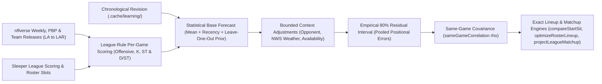

# Analysis and weekly learning

Seb estimates fantasy production from recorded NFL play-by-play and weekly statistics scored directly under the active Sleeper league's rules. Every projection exposes expected points, empirical uncertainty bounds, input game weeks, parameter provenance, intra-game correlations, and eligibility limits so the language model explains verified math rather than inventing numbers or editing learned weights.



## Choose an analysis

| Request | Tool | Numerical method |
| --- | --- | --- |
| Project one player or D/ST | `projectPlayer` | League-scored game history, exponential recency, and leave-one-out position prior (or 3-way D/ST mixture) |
| Project a batch | `projectPlayers` | Up to 40 names (4 concurrent), league scoring, explicit per-player missing/partial scope |
| Compare 2–6 starters | `compareStartSit` | Expected points, automatic flex-slot inference or explicit slot check, and correlated win probabilities |
| Optimize a full starting lineup | `optimizeRosterLineup` | Exact combinatorial solver across up to 12 non-bench slots and 60 candidates, locking kicked-off players |
| Predict a live league matchup | `projectLeagueMatchup` | Verified starters, completed Sleeper scores, remaining projections, and covariance-adjusted win odds |
| Compare historical roster scores | `predictMatchup` | Completed roster score histories and stated normal win-probability heuristic |
| Find waiver targets | `rankWaiverTargets` | League availability, common forecast + historical production, roster need, platform demand, and FAAB rules |
| Evaluate a trade | `analyzeTradeImpact` | Exact optimal offensive starting lineup before and after the proposed swap |
| Simulate playoff odds | `simulatePlayoffOdds` | Up to 50,000 Monte Carlo trials over actual remaining matchups with optional `matchupCorrelation` |
| Review or update weekly learning | `inspectLearning` / `learnCompletedWeek` | Rolling chronological train/validation split, MAE + RMSE promotion gates, and checksummed revisions |

All analysis tools are read-only against Sleeper; only explicit `seb learn update` or `/skill weekly-learning` calls write local parameter revisions under `.cache/learning/`.

## Forecast calculation

For each eligible regular-season appearance before the target cutoff, Seb scores component statistics using the league's exact rules, blends the full-sample mean with an exponential recency average, and shrinks toward a leave-one-out position prior once at least 20 peer observations exist:

```text
recent_weight = 2 ^ (-appearances_ago / halfLife)
base = (1 - recentWeight) * mean + recentWeight * weighted_mean
expected_points = (games * base + priorGames * position_mean) / (games + priorGames)
```

When fewer than 20 peer games exist, `expected_points` equals `base`. Default parameters are `recentWeight = 0.25`, `halfLife = 4`, and `priorGames = 0.5`, dampening small-sample spikes without overriding established starter workloads. Bounded opponent, NWS kickoff weather, and availability heuristics apply transparently after the statistical base forecast; each result returns `expectedPoints` (mirrored in `median` for backward compatibility) alongside a `model` descriptor recording version, effective parameters, learned season/week, and override status.

### Scoring and input safeguards

Seb computes component fantasy points across passing, rushing, receiving, kicking, team D/ST, and individual special-teams categories:

- **Offensive & individual special teams**: Covers standard yardage/TDs, volume/attempt scoring, reception and position-tiered PPR premiums (`bonus_rec_rb`, `bonus_rec_wr`, `bonus_rec_te`), fumbles, 2-point conversions, fumble-recovery TDs, kick/punt return yardage, special-teams TDs (`st_td`), and play-by-play enriched **individual special-teams forced fumbles (`st_ff`), fumble recoveries (`st_fum_rec`), and solo tackles (`st_tkl_solo`)**.
- **Exclusive Sleeper yardage bonuses**: Tiered yardage bonuses follow [Sleeper's exclusive-tier rules](https://support.sleeper.com/en/articles/3998131-what-scoring-options-are-available)—for example, a 400-yard passing game awards the 400+ bonus rather than stacking the 300–399 bonus.
- **Kicking**: Supports made/missed FGs and PATs, blocked kicks (scored as misses), total FG yards, yards over 30, legacy `50+` tiers, and split `50–59` / `60+` distance tiers (requiring complete attempt distance lists). Kickers use fixed default or manual-override parameters rather than offensive learned weights.
- **Strict validation & cutoffs**: Non-numeric or non-finite scoring weights and missing required stat columns throw explicit errors—Seb never silently substitutes `0`. Duplicate player-week rows and ambiguous historical identities are rejected, nflverse `'LA'` codes map deterministically to `'LAR'`, and postseason games are excluded from regular-season training. Week 1 (or unpublished early-season stat releases under automatic windows) falls back to the prior regular season; explicit season windows preserve missing-data errors instead of silently swapping years.

Starter recommendations require at least **three observed games**, a verified active team and future kickoff time, and complete support for all active scoring rules. When comparing players across positions in `compareStartSit`, omitting `slot` automatically infers the **narrowest compatible flex slot** from the league's `roster_positions` (such as `WRRB_FLEX`, `REC_FLEX`, `FLEX`, or `SUPER_FLEX`), while an explicit `slot` is validated against both candidate positions and the league's configured starter slots. Historical projections ignore current-day injuries, later team transfers, and post-kickoff recorded weather, whereas live recommendations require fresh status and news checks covering every compared candidate individually.

## Forecast uncertainty

When at least 20 historical validation residuals exist for a position, Seb sets a symmetric 80% prediction interval around the forecast center using the finite-sample-corrected 80th percentile of absolute errors—pooling positional residuals across earlier validation weeks in the season when recent three-week windows are still accumulating samples. Below 20 residuals, Seb falls back to a wider sample-variance interval labeled `uncalibrated-small-sample`. Intervals allow negative fantasy scores, borrow conformal residual-rank mechanics without claiming distribution-free individual coverage under mid-season role shifts, and keep `confidence` strictly as an evidence-completeness metric rather than a personal win rate.

### Same-game covariance ($\rho$) reference

When complete player uncertainty intervals are available on a shared scheduled game, `compareStartSit` and `projectLeagueMatchup` adjust pairwise difference and roster-sum variances using `sameGameCorrelation` (`src/projection/comparison.ts`):

| Pairing in the same scheduled NFL game | Correlation ($\rho$) | Football mechanism |
| --- | ---: | --- |
| Same-team `QB` + `RB` / `WR` / `TE` | `+0.30` | Shared passing touchdowns, yardage, and scoring drives |
| Same-team skill pair (`RB` / `WR` / `TE` with `RB` / `WR` / `TE`) | `-0.10` | Red-zone and target/touch opportunity cannibalization |
| Same-team `K` + `QB` / `RB` / `WR` / `TE` | `+0.10` | Shared offensive drive volume producing PATs and field goals |
| `QB` / `RB` / `WR` / `TE` / `K` vs. opposing `DEF` | `-0.25` | Negative coupling across points allowed, sacks, and turnovers (verified via mutual opponent schedule check) |
| Opposing `QB` / `WR` / `TE` vs. `QB` / `WR` / `TE` | `+0.12` | Shared game pace and pass-heavy shootout scripts |

`compareStartSit` flags the top two choices as a close call whenever the estimated head-to-head advantage probability falls below `60%`.

## Lineups, trades, waivers, and playoffs

### Roster lineup optimization and trade value

`optimizeRosterLineup` projects active starters and bench candidates for a Sleeper roster and solves the exact maximum-expectation legal assignment across **up to 12 non-bench starter slots of any supported type** (including `QB`, `RB`, `WR`, `TE`, `K`, `DEF`, `FLEX`, `WRRB_FLEX`, `REC_FLEX`, `SUPER_FLEX`, and `IDP_FLEX` slot parsing) and **up to 60 candidate players**. Any starter or bench player whose game has already kicked off is locked in place so mid-slate optimization only proposes legal pre-kickoff swaps, and unsupported IDP candidates are surfaced explicitly rather than scored as zero.

`analyzeTradeImpact` applies the same exact slot assignment to compare optimal starting offensive lineups before and after a trade (canceling unchanged kicker and defense slots) alongside raw bench-summed totals—catching 2-for-1 bench consolidations that raise total roster points while lowering weekly starter output. Missing identities, unsupported slots, draft picks, keeper contracts, and unverified player news block an automatic accept/decline verdict.

### Waiver ranking and playoff simulations

`rankWaiverTargets` combines league availability, common-forecast `expectedPoints`, historical production, positional roster need, platform-wide Sleeper add trends, and waiver settings (letting explicit priority waivers override leftover FAAB fields and withholding bid ranges when remaining FAAB sits below the league minimum).

Historical standings reconstruct wins, ties, commissioner score overrides, and league-median extra results strictly through the requested week cutoff without leaking current-week record totals. `simulatePlayoffOdds` requires at least two completed scores per roster, valid paired historical matchups, contiguous remaining regular-season schedules, and non-division seeding. Weekly team scores blend season (`70%`) and recent (`30%`) averages under normal draws (minimum SD `8.0`, optional head-to-head `matchupCorrelation`), ranking playoff seeds by [Sleeper tiebreakers](https://support.sleeper.com/en/articles/4238872-can-i-set-tiebreakers) (record $\rightarrow$ points for $\rightarrow$ points against $\rightarrow$ seeded tiebreak) across 10,000 default trials (up to 50,000 trials and 32 rosters, yielding every 250 iterations for cancellation).

## Update local learning

Run a weekly learning update after every game in the target week is final, at least 24 hours have elapsed since each kickoff, and weekly player statistics are published:

```bash
seb learn update --season 2026 --through-week 1 --league LEAGUE_ID
seb learn status --season 2026 --league LEAGUE_ID
seb learn status --season 2026 --league LEAGUE_ID --json
# Prepare a Week 1 baseline from the prior completed season:
seb learn update --season 2025
```

Omit `--through-week` to advance through the latest contiguous completed week, or omit `--league` to use the explicit default PPR profile recorded in the output JSON. Inside interactive chat, run `/skill weekly-learning Review the last completed week and update learning for my selected league.` (Seb never installs background cron jobs automatically).

### Parameter promotion

Each update builds chronological samples from games where a player has at least three prior appearances, evaluates a candidate grid (`recentWeight` in `{0, 0.25, 0.5}`, `priorGames` in `{0, 0.5, 2}`, `halfLife = 4`) on earlier training weeks, and reserves the final three completed weeks for out-of-sample validation. Candidate promotion requires at least **100 training samples across $\ge 3$ weeks**, **100 validation samples across $\ge 3$ weeks**, a **$> 1\%$ validation MAE improvement** over the versioned default, and **non-increasing validation RMSE**; otherwise the fixed defaults remain active (as occurred at every weekly step in 2024 and 2025 historical backtests, while synthetic trend suites confirm promotion when both gates pass).

### Storage and privacy

```text
.cache/learning/
  overrides.json
  .update-lock/
  2026-<scoring-profile-hash>/
    01-<content-sha256>.json
    02-<content-sha256>.json
```

Each immutable revision (`<= 8 MiB`, retaining up to four upstream stat-correction revisions per week) stores schema/model versions, scoring rules, selected and candidate parameters, validation residuals, nflverse player usage summaries, team error/bias diagnostics, source URLs, and a SHA-256 content checksum written via atomic rename under `.update-lock`. Revisions contain football statistics only—never prompts, completions, or API keys—and survive `seb cache clear` and `seb stats clear`.

### Overrides and rollback

Place `.cache/learning/overrides.json` (`<= 16 KiB`, validated by `seb doctor --offline` and reported by `seb learn status`) to disable learned revisions or pin bounded manual parameters without reusing mismatched residual calibrations:

```json
{
  "schemaVersion": 1,
  "enabled": true,
  "parameters": {
    "recentWeight": 0.25,
    "halfLife": 4,
    "priorGames": 0.5
  }
}
```

| Parameter | Meaning | Allowed range |
| --- | --- | --- |
| `recentWeight` | Weight assigned to the exponential recency average | `0` – `0.75` |
| `halfLife` | Appearances before an observation's recency weight halves | `1` – `12` |
| `priorGames` | Equivalent games assigned to the leave-one-out position prior | `0` – `12` |

> [!CAUTION]
> Never hand-edit a `<week>-<sha256>.json` revision file—checksum verification will reject the altered file. Set `"enabled": false` or copy target `parameters` into `overrides.json` instead, and verify no `seb learn update` process is running before removing a stale `.update-lock` directory.

## Verify forecast quality

```bash
seb evaluate --season 2024 --through-week 18 --output evaluation-2024.json
seb evaluate --season 2025 --through-week 18 --output evaluation-2025.json
```

`seb evaluate` benchmarks the legacy formula, fixed ensemble, and weekly adaptive learner walk-forward across regular-season Weeks 4–18 (`QB`, `RB`, `WR`, `TE` with $\ge 3$ prior appearances and observed outcomes), reporting MAE, RMSE, bias, 80% interval coverage and Winkler interval score, Spearman/pairwise ranking, synthetic neighbor-rank decision regret, and probability calibration (Brier score and ECE). Do not compare `seb evaluate` headline numbers directly against `seb replay`, which uses a broader prior-week-appearance target pool; see the [evaluation guide](EVALUATION.md) and [saved 2024–2025 benchmark summary](benchmarks/projections-2024-2025.json).

| Season | Player-week outcomes | Legacy MAE | Ensemble MAE | Legacy RMSE | Ensemble RMSE | Legacy coverage | Ensemble 80% coverage |
| --- | ---: | ---: | ---: | ---: | ---: | ---: | ---: |
| 2024 | 4,227 | 4.655 | 4.640 | 6.483 | 6.411 | 52.4% | 80.6% |
| 2025 | 4,325 | 4.598 | 4.567 | 6.513 | 6.405 | 54.2% | 80.2% |

Point-error gains are modest (`2024` informed default `priorGames`, `2025` served as out-of-sample holdout), wider empirical intervals restore nominal ~80% coverage, and historical replays cannot reconstruct historical injury-report timestamps or live roster constraints.

## Performance and research basis

Local Node.js 22 benchmarks ([analysis-performance.json](benchmarks/analysis-performance.json)) complete one weekly learning update (`19,400` rows) in **76 ms**, exact 60-player / 12-slot lineup optimization in **62 ms**, and a maximum 32-roster / 15-week / 50,000-trial playoff simulation in **2.80 s**.

| Primary reference | Application in Seb | Scope limit |
| --- | --- | --- |
| [Hyndman & Athanasopoulos: Time-series CV](https://otexts.com/fpp3/tscv.html), [Combinations](https://otexts.com/fpp3/combinations.html), [Distributional accuracy](https://otexts.com/fpp3/distaccuracy.html) | Walk-forward cutoffs, simple mean/recency shrinkage, and interval-score evaluation | Revised public stats cannot recreate exact live feed latencies; aggregate coverage is pooled by position |
| [Gibbs & Candès (arXiv:2106.00170)](https://arxiv.org/abs/2106.00170) & [Report the Floor (arXiv:2606.09473)](https://arxiv.org/abs/2606.09473) | Explicit baseline comparisons and rolling empirical residual intervals | Uses empirical residual ranks rather than online adaptive conformal step updates |
| [Playoff-aware trade optimization (arXiv:2511.17535)](https://arxiv.org/abs/2511.17535) & [nflverse `ff_opportunity`](https://nflreadr.nflverse.com/reference/load_ff_opportunity.html) | Separating optimal starter value from bench-summed points; candidate future features | Exact weekly slot solver (no dynasty/genetic claims); expected-opportunity features are not yet ingested |
| [Sleeper scoring options](https://support.sleeper.com/en/articles/3998131-what-scoring-options-are-available) | Component scoring rules and exclusive yardage bonus tiers | Unrecognized custom league rules still produce explicit partial-scoring flags |

## Missing projections

Seb projects `QB`, `RB`, `WR`, `TE`, `K`, and team `DEF` (`D/ST`; see [Defense and special teams](DEFENSE_AND_SPECIAL_TEAMS.md)). Individual defensive player (`IDP`: `DL`, `LB`, `DB`) projections remain unsupported and return explicit unavailable entries—never `0`.

Every projection reports `scoreScope` as `weekly-estimate` (complete active scoring and scheduled matchup), `partial-scoring` (one or more unrecognized custom league scoring keys omitted), or `historical-baseline` (missing current team, bye/unscheduled week, or already started game). Batch calls (`projectPlayers`) report `complete: true` only when every requested subject achieves `weekly-estimate`. `projectLeagueMatchup` combines verified completed Sleeper starter scores (including completed defenses) with remaining `weekly-estimate` projections, keeping commissioner overrides separate and computing `winProbability` and `stackCorrelations` whenever all active starters have complete intervals; model answers must cite those returned subtotals directly without re-summing individual starters.
