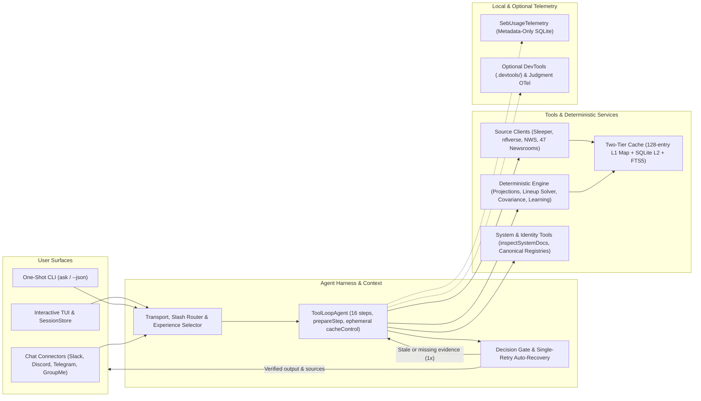
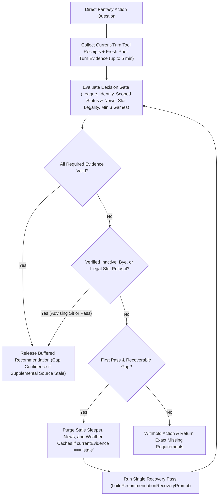

# Architecture guide

Seb separates user surfaces, resilient public-source ingestion, deterministic fantasy analysis, and model explanation so that factual claims and lineup actions remain grounded in verifiable runtime evidence. Direct tools fetch current league, schedule, statistical, weather, and news records, deterministic TypeScript services compute projections and lineup math, and an evidence-backed Decision Gate validates every direct fantasy recommendation before output reaches the user.



## Request flow

1. **Startup and configuration**: The CLI parser or connector bootstrap resolves CLI flags, loads saved user defaults from `~/.config/seb/` via `loadUserEnvironment(process.env, true)` for any unset environment variables, initializes optional Judgment OpenTelemetry tracing, and constructs the active model provider.
2. **Session hydration**: Seb refreshes the current NFL state, Sleeper season, discovered leagues, owned rosters, and league scoring/waiver/playoff settings into the session state (restoring prior transcript state from `SessionStore` when resuming an interactive session).
3. **Routing and experience selection**: Local slash commands execute immediately without a model call; natural-language prompts select the `Explore`, `My Fantasy`, or `Analyze` experience (plus any active skill) and enter the two-pass turn compactor.
4. **Tool-loop research**: AI SDK `ToolLoopAgent` runs up to 16 model steps with schema-validated tools, tool-input examples middleware, canonical identity resolution (`resolveTeamIdentity`, `resolvePlayerIdentity`), on-demand architecture/CLI reference lookup (`inspectSystemDocs`), and `toModelOutput` payload compaction.
5. **Source retrieval and deterministic math**: Source clients read the 128-entry in-memory L1 cache or `.cache/seb.sqlite` L2 cache before fetching remote endpoints (`SleeperClient`, `NflverseClient`, `WeatherClient`, `NewsClient` across 47 built-in publishers, plus optional Gemini Search and URL Context when Google is active). Deterministic TypeScript functions compute projections, same-game correlations, optimal lineups, waiver scores, trade impacts, and playoff odds.
6. **Decision Gate and auto-recovery**: For direct fantasy action questions, the buffered response and recorded `(input, output)` tool pairs pass through the deterministic Decision Gate (reusing fresh prior-turn evidence up to 5 minutes old). If required evidence is missing or stale on the first pass, Seb clears stale caches when needed and runs one targeted recovery pass via `buildRecommendationRecoveryPrompt` before finalizing or withholding an unsupported recommendation.
7. **Presentation and telemetry**: The transport attaches validated HTTP/HTTPS source links, updates contextual follow-up actions, persists metadata-only run/step/tool metrics through `SebUsageTelemetry`, and streams sanitized Markdown, cards, badges, and tables to the terminal or chat platform.

## Agent harness

Seb orchestrates model execution through AI SDK `ToolLoopAgent` with strict Zod input schemas covering seasons, weeks, team codes, limits, roster slots, and entity IDs. Each agent run allows at most **16 model steps** (`0` through `15`), where a single step may execute multiple tool calls in parallel (`projectPlayers`, for example, evaluates up to 40 player names with four concurrent projections while reporting missing players individually).

Before every step, `prepareStep` manages context budgets, provider caching, and final-answer synthesis:

- **Context pruning and two-pass turn compaction**: Individual prompts are capped at 32,000 characters. Interactive sessions retain up to 24 recent messages and apply a two-pass compactor that keeps up to 3 recent turns uncompacted within a 120,000-character budget, replacing older turns' bulky tool outputs with compact verified receipts (`[Verified tool calls in this turn (outputs compacted): ...]`). Within the active turn, `pruneMessages` strips prior-turn reasoning and stale tool payloads while preserving every current-turn tool call, result, and provider thought signature.
- **Prompt caching and forced synthesis**: On Anthropic models, `prepareStep` attaches per-step `cacheControl: { type: 'ephemeral' }` markers so stable system instructions, tool declarations, and conversation prefixes hit Anthropic's ephemeral prompt cache across steps. When the loop reaches step `15` (the 16th step) or prepared messages reach 200,000 estimated characters, Seb switches to static synthesis instructions and disables further tool execution (`activeTools: []`), keeping function declarations attached so Gemini emits an explicit `NONE` function-calling config while removing hosted provider tools.
- **Tool set and news routing**: Every production provider receives first-class data, analysis, learning, identity, system-docs (`inspectSystemDocs` in `src/system/tools.ts`), and `searchFirstClassNews` tools. Only the Google Gemini provider additionally receives hosted Google Search (secondary public coverage) and URL Context (for user-supplied URLs); test harnesses can inject custom agents with news tools disabled.
- **Structured `--json` execution**: `seb ask --json` runs a two-stage flow—first executing the tool-enabled research agent to collect grounded evidence and source records, then passing that evidence to a tool-free `Output.object` pass validated against Seb's Zod analysis schema (`schemaVersion: 1`) before applying the Decision Gate and rendering the compatible `answer` text.

> [!IMPORTANT]
> Tools are strictly read-only against external platforms and never submit Sleeper lineups, waiver claims, trades, or commissioner changes. Local side effects are confined to SQLite caches/snapshots, metadata telemetry, session files, and explicit football learning revisions.

### Cancellation, streaming completion, and fallback

Every interactive turn, local network slash command, CLI invocation, and connector reply binds an `AbortSignal` that propagates through `ToolLoopAgent` into every client download, gzip expansion, SQLite shared-refresh wait, and retry backoff timer. Connector replies enforce a shared two-minute deadline across primary and fallback models and abort all active streams on service shutdown.

Completion rules distinguish ordinary prose from gated decisions:

- **Structured JSON and connector replies** require a clean `stop` finish event; intermediate `tool-calls` steps never complete an answer.
- **One-shot text commands** retain partial non-decision prose with an explicit warning if generation hits an output-token or step limit, whereas buffered decision responses withhold recommendations on incomplete finishes, content filters, or cancellations.
- **Interactive tool approvals** can pause cleanly on `tool-calls` and clear pending state when denied.
- **Capacity fallback**: Seb retries the same-provider fallback model only when a rate-limit or capacity error occurs before visible output starts. Timeouts and user cancellations never trigger fallback retries.

## Interactive renderer, transport, and sessions

Seb owns its terminal user interface, prompt editor, and conversation loop while speaking public AI SDK `ChatTransport`, UI message, and `readUIMessageStream` contracts without private SDK imports. The TUI starts immediately while background session hydration finishes; pressing `Escape` aborts the active model stream and underlying network readers, isolating late chunks so they cannot leak into subsequent turns.

The custom `ChatTransport` wraps `DirectChatTransport` (with source stream parts enabled) to handle local slash commands, `/explore` / `/fantasy` / `/analyze` experience switches, inline `/skill NAME QUESTION` invocations, `/new` context boundaries, and live `/provider` or `/model` verification before swapping agents. Provider reasoning streams into a muted collapsible region excluded from clipboard copies, rapid token updates coalesce to animation frames, mouse wheel scrolling preserves reading position, and a stateful ANSI/OSC text sanitizer strips untrusted terminal control sequences across streamed chunks.

### Session context and resumable transcripts

In-memory session state tracks the active experience, NFL season/phase/week, Sleeper username/user ID, discovered leagues and owned rosters, league scoring/waiver/playoff rules, focused league/roster/team/player subjects, active skill, model display state, token totals, and `/new` context boundaries. Trusted skill instructions travel via system call options, whereas runtime session JSON is attached to the user message as untrusted context data (capped per string field so league or team names cannot inject prompt instructions).

Interactive transcripts also persist to `~/.config/seb/sessions/<id>.json` through `SessionStore`, allowing users to list and resume saved conversations via `seb sessions` and `seb resume <session-id>` while keeping local command outputs stripped from model context. Prompt history saves separately to `~/.config/seb/history.json` through a serialized write queue with unique `0600` temporary files and bounded regular-file reads.

## User settings and model provider configuration

Seb supports **Google Gemini**, **Anthropic**, **OpenAI**, and **OpenAI-compatible** chat endpoints. Persistent user files live in `~/.config/seb/` (overridable via `SEB_CONFIG_HOME` or `XDG_CONFIG_HOME`; see the [setup guide](SETUP.md) and [storage guide](STORAGE.md)):

| Store | Purpose | Security & validation |
| --- | --- | --- |
| `settings.json` | Non-secret persistent environment defaults (`NWS_USER_AGENT`, default Sleeper username, model/tracing preferences) managed via `configuration-registry.ts`. | Atomic `0600` write; explicit imports cannot redirect config directories or silently inject remote compatible endpoints. |
| `credentials.json` | Masked API keys and canonical base-URL bindings for OpenAI-compatible keys. | Atomic `0600` write, 64 KiB cap; verified via `seb configure` outside chat transcripts. |
| `model-settings.json` | Saved active provider, primary/fallback model IDs, and optional compatible base URL. | Atomic `0600` write, bounded schema, no secrets stored. |
| `profile.json` | Optional default Sleeper username, schema version, and update timestamp. | Atomic `0600` write; never stores API keys. |
| `history.json` & `sessions/<id>.json` | Interactive input history and resumable conversation sessions (`SessionStore`). | Serialized atomic `0600` writes and bounded file-size checks. |

Both CLI commands and chat connector processes call `loadUserEnvironment(process.env, true)` at startup before tracing and provider initialization. Saved values in `~/.config/seb/` populate unset settings as defaults, while explicit `process.env` variables and CLI flags (`--provider`, `--model`) always take precedence. Neither CLI nor connector processes auto-load a working-directory `.env` file.

When resolving a provider without an explicit CLI flag, Seb checks `SEB_MODEL_PROVIDER`, then the saved active provider, and finally auto-discovers configured credentials in order: Google, Anthropic, OpenAI, and OpenAI-compatible. Explicit single-model overrides (`--model` or `/model`) use the chosen model as its own fallback, whereas provider-level selection preserves that provider's configured fallback model. OpenAI-compatible endpoints require HTTPS for remote hosts (permitting HTTP only on loopback addresses), reject embedded URL credentials/queries/fragments/completion paths and HTTP redirects, and require interactive confirmation before sending prompts to a new remote origin.

## Source clients and two-tier cache

Four typed clients encapsulate external public data:

- **`SleeperClient`**: Reads Sleeper REST JSON endpoints for NFL state, users, leagues, rosters, matchups, transactions, player profiles, and add/drop trends.
- **`NflverseClient`**: Streams and parses gzip-compressed CSV releases (`schedules`, `stats_player`, `pbp`, and `stats_team`) with bounded compressed and expanded byte limits.
- **`WeatherClient`**: Queries National Weather Service (`/points`, `forecastHourly`, `/alerts/active`) GeoJSON endpoints with strict coordinate validation, origin verification on returned forecast URLs, required `NWS_USER_AGENT` headers, indoor/dome bypasses, and kickoff-window alert filtering.
- **`NewsClient`**: Searches **47 built-in 3-tier news sources** (15 official NFL, independent national, and fantasy outlets plus all 32 NFL team newsrooms), validates publication dates, indexes articles in SQLite FTS5 (`news_articles_fts`) for Porter-stemmed BM25 ranking, and clusters multi-publisher stories within a **36-hour** window via `corroboratedBy`. Before fetching feeds or publisher pages, `NewsClient` enforces an inline RFC 9309 `robots.txt` parser with per-origin crawl delays, response byte caps, and same-site redirect checks.

Every client accepts an injected `fetch` implementation for offline testing and wraps network I/O in `ResilientFetch` (exponential full-jitter backoff, `Retry-After` support, transient/Cloudflare `520–524, 529` retries, per-origin 30-second circuit breakers, and caller-scoped abort propagation that never penalizes shared circuit health on user cancellation).

### Caching, snapshots, and canonical identities

`CachedResource` implements a **two-tier cache**: a bounded **128-entry L1 in-memory `Map`** sits in front of SQLite L2 (`.cache/seb.sqlite` in WAL mode with a 5-second busy timeout) so repeated player, schedule, and roster lookups inside multi-player projections avoid redundant SQLite reads and JSON parsing. Cache hits validate URL equality, source schema version, and SHA-256 payload checksums, recalculating freshness from stored retrieval timestamps. Concurrent callers in the same process share one in-flight refresh per key while retaining independent `AbortSignal` handles and stale-if-error fallbacks; `304 Not Modified` responses via `ETag` / `Last-Modified` extend freshness in place, and `/refresh` commands bump durable namespace generations without deleting historical snapshots.

Successful updates write versioned snapshots paired with JSON Pointer field-level provenance manifests (capped at 2,000 leaf paths before falling back to root lineage; inspectable via `seb snapshots` and `/provenance`). Cross-provider joins pass through `TeamIdentityRegistry` (`nfl-team:CODE`) and `PlayerIdentityRegistry` (`strict` name-position-team matching plus guarded active-player transfer fallback), persisted with SHA-256 checksums in `IdentityRepository`. See the [storage guide](STORAGE.md), [provenance guide](PROVENANCE.md), and [identity guide](IDENTITIES.md) for complete schemas.

## Deterministic analysis and Decision Gate

Plain TypeScript services compute player rolling/recency averages, target and air-yards shares, PPR volatility, team records and defensive positional points allowed, NWS kickoff weather risk, scoring-aware offensive/kicker/D/ST projections, intra-game covariance (`sameGameCorrelation`), full-roster combinatorial starter optimization (`optimizeRosterLineup`), trade lineup deltas (`analyzeTradeImpact`), waiver rankings (`rankWaiverTargets`), and Monte Carlo playoff odds (`simulatePlayoffOdds`). Local weekly learning (`learnCompletedWeek`) writes chronologically validated parameter revisions to `.cache/learning/` without modifying code or prompts; see the [analysis guide](ANALYSIS.md) and [evaluation guide](EVALUATION.md).

Whenever a user asks for a direct fantasy action (start/sit, lineup optimization, waiver add/drop, or trade verdict), Seb buffers the model's draft and evaluates the deterministic **Decision Gate** against actual executed tool inputs and outputs—never trusting model prose about which tools ran.



Key Decision Gate behaviors across interactive chat, `seb ask` / `seb ask --json`, and all chat connectors include:

- **5-minute prior-turn evidence reuse**: Follow-up turns reuse verified tool evidence recorded within the last 5 minutes in the same session so conversational follow-ups do not needlessly re-fetch unchanged rosters, projections, or news.
- **Scoped subject verification and legal refusals**: Status and current-news checks scope specifically to the recommended starters and compared action subjects rather than every bench player on a roster. When verified evidence proves a subject is Out, on IR, on bye, already kicked off, or ineligible for the requested slot, the gate permits explicit refusal advice (for example, advising to sit or avoid that player) without false blocking.
- **Automatic single-retry recovery**: If an action draft fails the gate because required tool calls were skipped or returned stale current evidence (`currentEvidence === 'stale'`), Seb automatically purges stale Sleeper, news, and weather cache namespaces when needed, builds a targeted recovery instruction via `buildRecommendationRecoveryPrompt`, executes **one** recovery agent pass, and re-runs the gate before falling back to an explicit missing-evidence message.

## Local usage analytics and tracing

Seb instruments every interactive, CLI, connector, setup, doctor, and contract run through AI SDK's telemetry interface:

- **Metadata-only SQLite analytics (`SebUsageTelemetry`)**: Records runs, logical model steps, token classes (input, cache-read, cache-write, output, text, reasoning, tool-use, AI SDK normalized total, and Google provider total/grounding/service-tier fields), step latencies, and client vs. provider tool durations in `.cache/seb.sqlite`. Missing metrics stay `NULL` rather than `0`, terminal status transitions enforce monotonic precedence (`aborted` > `failed` > `completed`) while preserving the first terminal timestamp, and `/usage` or `seb stats` aggregates up to the 10,000 newest runs (`schemaVersion: 1`). `SebUsageTelemetry` never stores prompts, answers, tool payloads, raw error messages, API keys, or endpoint URLs.
- **Optional DevTools and Judgment OpenTelemetry tracing**: AI SDK's shared `recordInputs` and `recordOutputs` flags are `true` when **either** local AI SDK DevTools (`SEB_DEVTOOLS=true`, rejected when `NODE_ENV=production`, writing local traces to `.devtools/`) **or** optional Judgment OpenTelemetry tracing (`SEB_JUDGMENT_TRACING=true` in `src/ai/judgment.ts`) is active, and `false` when both are disabled. Even when shared input/output recording is enabled for DevTools or Judgment, `SebUsageTelemetry` discards content and writes metadata only. See the [AI SDK guide](AI_SDK.md#5-local-usage-telemetry) and [storage guide](STORAGE.md#usage-telemetry).

## Test design

Vitest (`5.0.5`) exercises source clients, two-tier caching, SQLite migrations, usage telemetry, canonical identities, provenance manifests, projections, lineup optimization, historical replay, CLI commands, TUI rendering/sanitization, and Chat SDK (`4.43.0`) connectors without live network calls or paid model credentials—using `MockLanguageModelV4`, injected `fetch` mocks, and `@chat-adapter/tests`. Live verification commands complement unit tests: `npm run data:smoke` probes nflverse and NWS without a model key, `npm run news:smoke` audits all 47 built-in news sources, and `npm run doctor` verifies end-to-end source health plus one streaming local tool continuation (and grounded Google Search when Gemini is active).

Run the complete local verification suite before every commit:

```bash
npm run check
```

## Extension points

Add a new external data source in this order:

1. Implement a typed client in `src/` that accepts an injected `fetch` function and `AbortSignal`.
2. Wrap HTTP calls in `ResilientFetch` with bounded timeouts, byte limits, retries, and per-origin circuit breaking.
3. Configure `CachedResource` (L1 + SQLite L2), `stale-if-error` windows, `/refresh` namespace registration, and snapshot retention.
4. Emit source observer events and JSON Pointer field-level provenance manifests.
5. Extend `TeamIdentityRegistry` or `PlayerIdentityRegistry` before joining records across providers.
6. Implement pure, deterministic TypeScript analysis transformations separate from model prompts.
7. Expose small Zod-validated read-only agent tools (with input examples and `toModelOutput` compaction if payloads are large).
8. Add unit, SQLite, and `MockLanguageModelV4` tool-loop tests, then wire `doctor` and smoke checks and update `docs/`.

To add a guided workflow skill, register it in `src/interactive/skills.ts` with a single focused purpose, explicit evidence rules, and starter follow-up suggestions—never granting authority to mutate external fantasy platforms.
