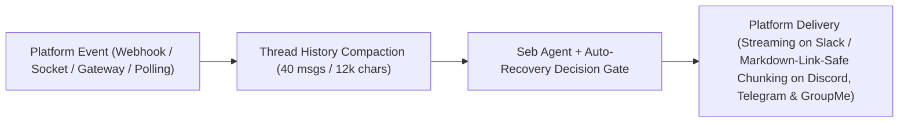

# Connector guide

Seb uses [Chat SDK](https://chat-sdk.dev) to run a single read-only fantasy football agent across Slack, Discord, Telegram, and GroupMe. Every connector shares the same Sleeper, nflverse, National Weather Service, and NFL news toolset, deterministic evidence checks, and per-thread conversation management.

## Quick choice

| Platform | Best local mode | Best deployed mode | Public HTTPS URL | Direct messages | Outbound delivery |
| --- | --- | --- | --- | --- | --- |
| [Slack](connectors/SLACK.md) | Socket Mode (`SEB_SLACK_MODE=socket`) | HTTPS webhook (`POST /webhooks/slack`) | Not required in Socket Mode | Supported | Native streaming (recommendations buffered for Decision Gate) |
| [Discord](connectors/DISCORD.md) | Gateway (`SEB_DISCORD_GATEWAY=true`) | Gateway + optional interactions webhook | Not required for mentions or DMs | Supported | Plain-text chunks up to `2,000` chars |
| [Telegram](connectors/TELEGRAM.md) | Long polling (`SEB_TELEGRAM_MODE=polling`) | HTTPS webhook (`POST /webhooks/telegram`) | Not required in polling mode | Supported | Plain-text chunks up to `4,096` chars |
| [GroupMe](connectors/GROUPME.md) | HTTPS tunnel (`cloudflared` or `ngrok`) | HTTPS webhook (`POST /webhooks/groupme`) | Always required | Group chats only | Plain-text chunks up to `1,000` chars |

Choose **Slack** when your league or analytics workspace already lives in Slack threads, or **Discord** when you run a resident Node process that can hold a Gateway WebSocket open. Choose **Telegram** for the fastest zero-tunnel local setup, and **GroupMe** for classic fantasy football league group chats powered by GroupMe Bot callbacks.

## Shared behavior



### Mentions, direct messages, and thread subscriptions

Seb responds to direct messages on Slack, Discord, and Telegram, while **GroupMe** bots operate exclusively in group chats (`isDM()` always returns `false`). Across every platform, mentioning Seb in a channel or group (matched against `SEB_BOT_NAME`, default `seb`) answers the question and subscribes that thread. Once subscribed, Seb automatically answers follow-up messages in the same thread without requiring another `@seb` mention.

### Thread history compaction

Before calling the model, Seb fetches up to **40** recent messages from the active thread (`HISTORY_LIMIT = 40`), coalesces adjacent same-role text segments, and strips prior `## Evidence` footers from historical assistant turns so follow-up prompts stay lean. History is bounded to a **12,000-character** budget (`MAX_HISTORY_CHARS = 12_000`) while always retaining and appending the incoming user turn last, ensuring coarse integer-second webhook timestamps (such as GroupMe's `created_at` values) never sort the current prompt behind an earlier message in the same second.

### Decision Gate and automatic recovery

When a prompt asks for an actionable fantasy call—such as start/sit, waiver wire, add/drop, or trade advice—Seb buffers the draft through its deterministic Decision Gate, matching executed tool inputs and outputs against the requested player and league. If live evidence is missing or stale on the initial pass, the connector clears stale caches and runs an **automatic single-retry recovery pass** to fetch fresh tool data before deciding whether to publish the answer or return `Decision unavailable`.

### Delivery, concurrency, and tools

Slack streams general research answers natively through its adapter, whereas Discord (`2,000` chars), Telegram (`4,096` chars), and GroupMe (`1,000` chars) emit a typing indicator when supported, wait for full completion, and split plain-text replies on newline or word boundaries without breaking `[label](url)` Markdown links or losing citation URLs. Overlapping messages in the same thread share a sequential queue (up to 10 queued turns with a 90-second TTL, dropping the oldest overflow), each turn enforces a 2-minute (`120s`) deadline across the primary and fallback model, and service shutdown (`SIGINT` or `SIGTERM`) cleanly aborts in-flight replies.

Every connector can call Seb's Sleeper, nflverse, National Weather Service, and 47 built-in NFL news tools; set `NWS_USER_AGENT` so weather requests identify your deployment, and optionally set `SEB_SLEEPER_USER` to preload default Sleeper user context. Google Search and URL Context grounding are available automatically when `google` is the active model provider, while interactive slash commands (`/league`, `/model`, `/doctor`) apply only to the terminal CLI.

## Model provider environment

At startup, [`src/connectors/server.ts`](../src/connectors/server.ts) calls `loadUserEnvironment(process.env, true)`, which loads saved `settings.json`, `credentials.json`, and `model-settings.json` files from `seb configure` whenever the corresponding environment variables are unset. Explicit `process.env` variables always take precedence over saved configuration files and are recommended for container and production deployments.

> [!NOTE]
> Seb does not automatically parse a `.env` file from the current working directory at startup. Export variables through your process manager, container secret store, or `node --env-file=.env`, or import supported model and Sleeper settings ahead of time with `seb configure --import-env .env`.

Select a provider with `SEB_MODEL_PROVIDER` (or let Seb infer it from your configured credentials) and supply the matching credentials:

| Provider (`SEB_MODEL_PROVIDER`) | Required environment variables |
| --- | --- |
| `google` | `GOOGLE_GENERATIVE_AI_API_KEY` or `GEMINI_API_KEY` |
| `anthropic` | `ANTHROPIC_API_KEY` |
| `openai` | `OPENAI_API_KEY` |
| `openai-compatible` | `OPENAI_COMPATIBLE_BASE_URL`, `OPENAI_COMPATIBLE_MODEL`, and optional `OPENAI_COMPATIBLE_API_KEY` |

Use `SEB_MODEL` and `SEB_FALLBACK_MODEL` for provider-neutral model overrides (`SEB_MODEL` preserves the provider's default fallback when `SEB_FALLBACK_MODEL` is unset), or set the provider-specific model variables documented in [the setup guide](SETUP.md#environment-reference). Seb switches to the fallback model only when the primary model fails with a capacity or rate-limit error before emitting visible output, never crosses provider boundaries during fallback, and disables fallback when primary and fallback model IDs are identical.

For `openai-compatible` endpoints, loopback HTTP URLs are permitted for local servers (such as Ollama, LM Studio, or vLLM), while remote endpoints must use HTTPS. Because the headless connector service cannot prompt interactively for remote endpoint approval, test and approve custom endpoints before deployment; connector replies always surface sanitized, provider-safe error categories rather than raw upstream payloads.

## Start the service

List the connectors you want to run in `SEB_CONNECTORS` (or leave `SEB_CONNECTORS` unset to auto-enable every platform with complete credentials in `process.env`), then start the HTTP and gateway runtime:

```dotenv
SEB_CONNECTORS=slack,discord,telegram,groupme
SEB_BOT_NAME=seb
NWS_USER_AGENT=seb-fantasy-bot (ops@example.com)
```

```bash
npm run connectors
```

The service listens on `HOST` (default `0.0.0.0`) and `PORT` (default `3000`) and exposes the following HTTP endpoints:

| Route | Purpose |
| --- | --- |
| `GET /` | Returns the service name, enabled connectors, and active webhook routes. |
| `GET /health` | Returns health status (`ok`), state backend (`memory` or `redis`), enabled connectors, and active background task count. |
| `POST /webhooks/slack` | Receives signed Slack Events API and interaction requests when `SEB_SLACK_MODE=webhook`. |
| `POST /webhooks/discord` | Receives Ed25519-signed Discord interaction webhooks when Discord is enabled. |
| `POST /webhooks/telegram` | Receives secret-token-verified Telegram webhook updates in `webhook` mode (or `auto` mode with a secret). |
| `POST /webhooks/groupme` | Receives shared-secret-verified GroupMe bot callbacks when GroupMe is enabled. |

> [!WARNING]
> Do not mount a JSON body-parsing proxy or middleware in front of `/webhooks/*` that mutates or re-serializes request bodies. Platform adapters verify cryptographic signatures directly against the raw HTTP payload.

## Local development

Leave `REDIS_URL` unset during local development to use Chat SDK's in-memory state adapter; subscriptions and message deduplication claims stay in memory and reset whenever the process stops. Three platforms can run locally without exposing a public URL, while GroupMe requires an HTTPS tunnel:

- **Slack**: Set `SEB_SLACK_MODE=socket` with an `xapp-` App-Level Token (`connections:write`).
- **Discord**: Keep `SEB_DISCORD_GATEWAY=true` (the default) so Seb receives mentions and DMs over an outbound WebSocket.
- **Telegram**: Set `SEB_TELEGRAM_MODE=polling` (and clear any prior webhook) to pull updates directly from Telegram.
- **GroupMe**: Because GroupMe delivers messages exclusively via outbound HTTP POST callbacks, forward local port `3000` through an HTTPS tunnel such as `cloudflared tunnel --url http://localhost:3000` or `ngrok http 3000` and register `https://<tunnel-domain>/webhooks/groupme?secret=<GROUPME_WEBHOOK_SECRET>`.

## Production

Set `REDIS_URL` before serving production traffic so thread subscriptions, webhook event deduplication claims, per-thread queues, and distributed locks persist in Redis (prefixed under `seb`). Serve all webhook endpoints over HTTPS (for example `https://seb.example.com/webhooks/{connector}`), terminate TLS on port `443` at your load balancer or reverse proxy, and keep the Node process bound to a private internal port. See [production operations](OPERATIONS.md) for deployment sizing, monitoring, and secret rotation guidance.

## Platform guides

- [Connector overview & comparison](connectors/README.md)
- [Slack setup](connectors/SLACK.md)
- [Discord setup](connectors/DISCORD.md)
- [Telegram setup](connectors/TELEGRAM.md)
- [GroupMe setup](connectors/GROUPME.md)
- [Other supported platforms](connectors/OTHER_PLATFORMS.md)
- [Custom adapter development](connectors/CUSTOM_ADAPTER.md)

Consult the [Chat SDK adapter directory](https://chat-sdk.dev/adapters) and [Chat SDK platform matrix](https://chat-sdk.dev/docs/platform-adapters) before adding rich cards, modals, or extra messaging platforms.
