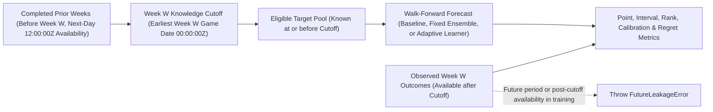

# Historical replay and metrics guide

Seb provides three deterministic walk-forward backtesting harnesses—`seb replay`, `seb evaluate`, and `scripts/benchmark-defense.ts`—so baseline reference metrics, production offensive projection ensembles, and team D/ST mixtures can be audited without leaking future game outcomes into historical forecasts.



## Choose an evaluation harness

Because each harness targets a specific modeling layer and player pool, never compare headline MAE/RMSE numbers directly across different commands:

| Harness | Command | Models compared | Positions & weeks | Scoring & target pool | Metrics emitted |
| --- | --- | --- | --- | --- | --- |
| **Reference rolling baseline** | `seb replay` (or `/replay`) | `0.7` full history + `0.3` last 3 games (position $\rightarrow$ global $\rightarrow$ `0` fallback; population-SD 80% interval) | `QB, RB, WR, TE, K`; Weeks `2–18` | Precomputed nflverse `fantasyPointsPpr`; targets = players appearing in the prior week | MAE, RMSE, bias, 80% coverage & width, Spearman & pairwise rank accuracy, per-week leakage audit |
| **Production offensive forecast suite** | `seb evaluate` | `legacy` (narrow range), `ensemble` (`recentWeight=0.25, halfLife=4, priorGames=0.5`), and `adaptive` (chronological weekly learner) | `QB, RB, WR, TE`; Weeks `4–18` | Exact league-component PPR scoring; targets require $\ge 3$ prior regular-season appearances and an observed outcome | MAE, RMSE, bias, empirical 80% coverage & Winkler interval score, Spearman/pairwise rank, **synthetic neighbor-choice regret**, **Brier score & ECE calibration** |
| **Team D/ST mixture benchmark** | `node --import tsx scripts/benchmark-defense.ts YEAR` | 3-way team/opponent/NFL mixture + 24-game TD prior vs. team-average and NFL-average baselines | Team `DEF` (`32` clubs); Weeks `5–18` | Sleeper D/ST component & points/yards-allowed tiers (`pbp` + `stats_team`) | MAE, RMSE, and descriptive 10th–90th percentile range coverage (`docs/benchmarks/defense-YEAR.json`) |

See [Verify forecast quality in the analysis guide](ANALYSIS.md#verify-forecast-quality) and [Defense and special teams](DEFENSE_AND_SPECIAL_TEAMS.md) for recorded `2024` and `2025` benchmark tables.

## CLI and interactive usage

Run `seb replay` or `seb evaluate` from the command line:

```bash
# Reference baseline replay (supports position filtering)
seb replay --season 2025 --through-week 10 --position QB,RB,WR,TE
seb replay --season 2025 --output exports/replay-2025.json
seb replay --season 2025 --json

# Production offensive model comparison (legacy vs. ensemble vs. adaptive)
seb evaluate --season 2025 --through-week 18 --output exports/evaluation-2025.json
```

| Option | Supported on | Validation rules & behavior |
| --- | --- | --- |
| `--season <YEAR>` | `seb replay`, `seb evaluate` | Integer season from `1999` through `2100`. |
| `--through-week <WEEK>` | `seb replay`, `seb evaluate` | Final regular-season week (`2`–`18` for `replay`; `4`–`18` evaluated in `evaluate`). |
| `--position <LIST>` | `seb replay` | Comma-separated subset of `QB`, `RB`, `WR`, `TE`, `K`. (`seb evaluate` always scores `QB,RB,WR,TE` with per-position breakdowns.) |
| `--output <PATH>` | `seb replay`, `seb evaluate` | Writes canonical sorted JSON (`schemaVersion: 1`) via a private `0600` temp file and atomic rename. |
| `--json` | `seb replay`, `seb evaluate` | Prints machine-readable JSON (`schemaVersion: 1`, rejecting non-finite numbers) to standard output. |

Inside interactive chat, `/replay [SEASON] [THROUGH_WEEK]` (for example, `/replay 2025 10`, defaulting to the previous season when omitted) runs the reference baseline summary directly in the transcript without `--position` or `--output` flags.

## Strict non-leakage rules

Every forecast week `W` establishes a single deterministic **knowledge cutoff** at `00:00:00Z` on the earliest scheduled game date of week `W`, and marks each completed game's statistics as `availableAt` `12:00:00Z` (noon UTC) on the calendar day after its game date:

1. **Training inputs** must come from an earlier week (`week < W`) *and* satisfy `availableAt <= cutoff`.
2. **Forecast targets** must exist on or before `cutoff` (for `seb replay`, players who recorded an appearance in the preceding week; for `seb evaluate`, players with at least three completed prior appearances).
3. **Target outcomes** must become available strictly after `cutoff` (`availableAt > cutoff`), with missing outcomes left missing rather than coerced to `0`.

Any violation immediately throws `FutureLeakageError`, and every JSON report embeds a per-week period audit tallying excluded late observations, future rows, and missing outcomes.

## Interpreting metrics and scope limits

- **Point & rank accuracy**: Lower **MAE** measures average point miss, while **RMSE** penalizes large bust/boom misses more heavily. **Pairwise rank accuracy** and **Spearman correlation** measure intra-week ordering quality across peers.
- **Intervals, calibration, and regret**: Nominal **80% interval coverage** should sit near `80%` without achieving coverage trivially via overly wide intervals (penalized by the interval score in `seb evaluate`). The shared metrics library also computes **Brier score**, **Expected Calibration Error (ECE)** across probability bins, and **mean/max/total decision regret**; those probability and regret fields are populated in `seb evaluate` (using adjacent-rank synthetic start/sit pairs) and remain zero-sample placeholders in `seb replay`, which emits point and interval baselines only.
- **Historical data boundaries**: Both runners read revised regular-season nflverse CSVs with deterministic next-day availability timestamps. Neither harness reconstructs live pre-kickoff injury reports, practice participation, depth-chart announcements, NWS forecast snapshots, intra-game stack correlations, or Sleeper roster-slot constraints—treat backtest reports as controlled statistical benchmarks rather than live league win-rate guarantees.
