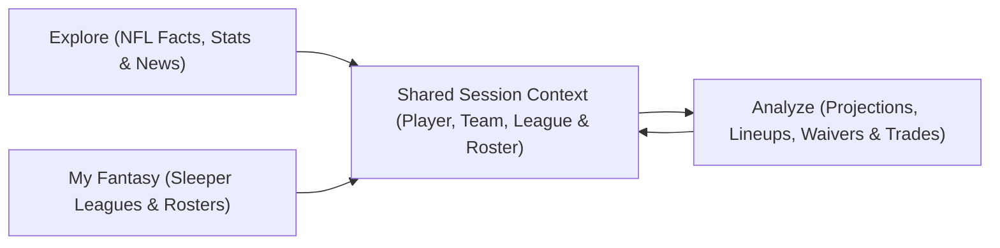

# Explore, My Fantasy, and Analyze

[Documentation Hub](README.md) · [Interactive Guide](INTERACTIVE.md) · [Skill Guide](SKILLS.md) · [Analysis & Learning](ANALYSIS.md)

Seb organizes interactive research around three connected experiences—**Explore**, **My Fantasy**, and **Analyze**—that share a single live session context. You can ask natural questions immediately without picking a mode first; `/explore`, `/fantasy` (`/my`), and `/analyze` switch the visible experience header and contextual suggestions cleanly without keyword-guessing behind your back.



## Explore

**Explore** answers NFL information questions across players, franchises, league-wide statistics, schedules, game results, and verified reporting from Seb's 47 built-in NFL newsrooms (plus grounded web search when Google Gemini is active). It requires **no Sleeper account** and stays objective rather than injecting unrequested fantasy lineup advice:

```text
Show Derrick Henry's current profile and recent game log.
What is the latest verified news about Baltimore?
Show the strongest rushing offenses this season.
```

## My Fantasy

**My Fantasy** layers personal Sleeper context onto live NFL data once you link a username via `/connect <USERNAME>` or `seb setup <USERNAME>`. Seb stores only your Sleeper username locally and refreshes everything else dynamically at session startup:

1. Fetches the live NFL season, phase, display week, and Sleeper league season (separating the NFL calendar from Sleeper's league year when they differ during the offseason).
2. Discovers every current-season NFL league for your account and identifies every roster you own or co-own.
3. Reads league scoring rules, roster slots, waiver budgets/schedules, playoff weeks, and trade deadlines.
4. Flags open starter slots, injured or bye-week starters, and nearby waiver or trade windows.

When you belong to multiple leagues, Seb maintains an **account-wide view** by default so broad questions scan all of your rosters at once—and **auto-resolves a single league's context automatically** whenever you ask about a player you own in only one league:

```text
What needs my attention across my leagues?
Show urgent news for players on my rosters.
Which league has the weakest running back depth?
```

> [!NOTE]
> Sleeper leagues can use custom daily waiver processing schedules where Sleeper's backend owns the exact live clearance countdown. Seb displays your league's configured waiver type, budget, and schedule fields transparently and notes whenever exact live countdowns live inside Sleeper.

## Analyze

**Analyze** turns the active player, team, or connected fantasy roster into concrete, scoring-aware comparisons and lineup decisions:

- **Player & team D/ST projections**: Generates scoring-aware median, floor, ceiling, confidence, matchup/weather adjustments, and explicit modeling limits across offensive skill positions, kickers, **and team D/ST units** (sacks, turnovers, defensive TDs, blocked kicks, safeties, and points/yards allowed tiers—see [Defense and special teams](DEFENSE_AND_SPECIAL_TEAMS.md)).
- **Special-teams return scoring & same-game stack correlations**: Accounts for active league kick/punt return yardage and return touchdown rules, and models **same-game stack correlations** (such as positive QB/pass-catcher ceiling correlation or negative correlation against an opposing D/ST) when evaluating upside vs. floor.
- **Head-to-head start/sit & full-roster lineup optimization**: Compares 2–6 candidates directly (`compareStartSit`) or optimizes your **entire starting lineup** (`optimizeRosterLineup`) across offensive slots, flex/superflex, kicker, and team D/ST—recommending highest-impact bench-for-starter swaps.
- **Auto-league context resolution**: If you belong to multiple leagues and ask a start/sit, projection, or trade question about a player rostered on **only one** of your teams, Seb automatically applies that league's scoring settings and roster context without requiring `/league <ID>` first.
- **Calibrated waivers & trade impact**: Ranks unrostered waiver targets using fixed positional production and platform-wide logarithmic demand (`0`–`1,000` adds) reference scales—so changing the candidate pool never distorts scores—alongside FAAB bid ranges and two-sided trade production, usage, volatility, and positional depth comparisons.

Because session context persists across turns, natural pronoun follow-ups work effortlessly from Explore straight into Analyze:

```text
Show Derrick Henry's player information.
Look deeper into his statistics.
Compare him with Saquon Barkley for the upcoming matchup.
```

## Decision safeguards

Every terminal session, `--json` CLI call, and chat connector enforces the same **Decision Gate** before presenting a start/sit, lineup swap, waiver, or trade recommendation:

- **Verified tool lineage**: Every named player and target league must match executed tool inputs and outputs in the current turn (or fresh session tool evidence verified within the last 5 minutes), covering player identity, active status, current news, and league scoring rules.
- **Projection & trade eligibility**: Start/sit and lineup recommendations require an eligible projection (sufficient completed games, available player status, supported position including K and team D/ST, complete stat inputs, and zero unsupported active scoring rules). Trade evaluations require unique players on each side with all incoming players belonging to a single opposing roster in that league.
- **Transparent fallback**: If required evidence remains incomplete even after Seb's automatic recovery check, Seb withholds the recommendation and lists the exact missing requirements instead of guessing.

## Progressive disclosure and state persistence

Seb surfaces urgent weekly actions and the three primary experiences first, keeping manual overrides (`/season`, `/week`, `/league`, `/roster`, `/team`, and `/skill` workflows) tucked cleanly under **Advanced** in the command palette (`Ctrl+K`) for historical research or single-league deep dives.

| Value | Source | Persistence |
| --- | --- | --- |
| Sleeper username | `seb setup` or `/connect` | Saved in `profile.json` |
| Model provider, families, and keys | `seb configure` or environment | Saved in `model-settings.json` / `credentials.json` or `process.env` |
| NFL season, phase, week, & league year | Sleeper `/v1/state/nfl` | Refreshed per session or one-shot request |
| Leagues, settings, & owned rosters | Sleeper user/league APIs | Rediscovered automatically from username |
| Active player, team, or skill workflow | Conversation turns or slash command | Current session (and saved in `sessions/<id>.json` for `seb resume`) |
| Focused league | Automatic single-league ownership match or `/league <ID>` | Current session (and restored on `seb resume`) |

If Sleeper account discovery fails temporarily at startup, **Explore** and **Analyze** remain fully usable while the header keeps your username with a refresh warning—run `/connect <USERNAME>` to retry or `/disconnect` to clear it. For upstream platform details, see the [Sleeper API docs](https://docs.sleeper.com/), [Sleeper trade deadline guide](https://support.sleeper.com/en/articles/2435411-when-is-my-trade-deadline), and [Sleeper custom waiver guide](https://support.sleeper.com/en/articles/3978868-waivers-for-regular-season-playoffs).
