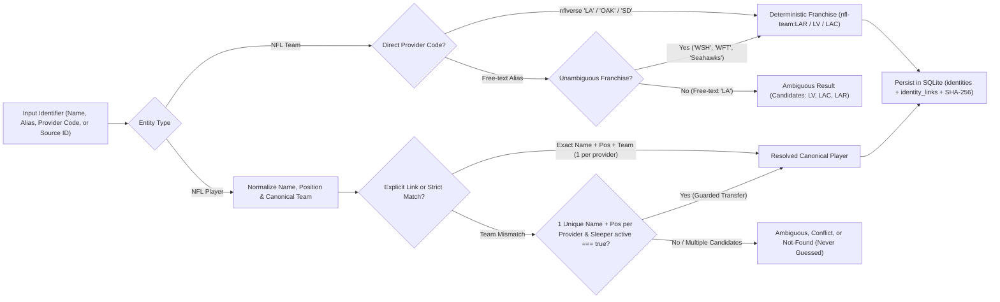

# Canonical identity guide

Seb maps disparate Sleeper and nflverse identifiers to canonical internal NFL team (`nfl-team:CODE`) and player (`nfl-player:...`) records so cross-provider joins never rely on raw display-name strings alone.

## NFL team identities

`TeamIdentityRegistry` ships a built-in catalog of all 32 current NFL franchises keyed by `nfl-team:CODE` (for example, `nfl-team:SEA` or `nfl-team:LAR`), storing each club's canonical code, city, nickname, historical aliases, and provider source codes:

- **Historical franchise aliases**: Former codes and names map cleanly to current franchises—`WAS`, `WSH`, and `WFT` resolve to `nfl-team:WAS`, while `OAK` maps to `nfl-team:LV` and `SD` maps to `nfl-team:LAC`.
- **Provider `'LA'` vs. free-text `'LA'`**: When parsing an explicit `nflverse` provider team code, `'LA'` maps deterministically to `nfl-team:LAR` (Los Angeles Rams) across schedules, weekly player logs, team defense statistics, and source links. By contrast, free-text `'LA'` in a user or tool query remains intentionally **ambiguous** across the three franchises with Los Angeles history (`LV`, `LAC`, and `LAR`) and returns those candidate teams rather than guessing; callers disambiguate with a current code (`LAR`, `LAC`, `LV`) or full team name.

## Player identities, `active` status, and matching strategies

Each resolved player record tracks a canonical ID (explicit or generated as URL-encoded `nfl-player:PROVIDER:SOURCE_ID`), display name (preferring nflverse formatting), normalized lookup key, uppercase position, optional canonical team ID, Sleeper **`active`** status flag, display aliases, and linked Sleeper/nflverse source IDs.

Name normalization strips case differences, diacritics, punctuation, suffixes, and irregular whitespace while resolving team fields through `TeamIdentityRegistry` first. Preserving Sleeper's boolean `active` flag governs both current-team assignment and retirement/inactive safety:

- **Active roster authority and guarded transfers**: An explicitly active (`active: true`) Sleeper profile supplies the linked player's current canonical team. Under production `strict` matching, Seb first requires exact normalized `name + position + canonicalTeam` with at most one candidate per provider; when a traded or signed veteran's historical nflverse team differs from their current Sleeper club, the guarded transfer fallback links them **only** if each provider has exactly one `name + position` candidate and the Sleeper profile is explicitly `active: true`.
- **Teamless and retired player detection**: Inactive or teamless Sleeper profiles (`active: false` or retired veterans without an active roster assignment) never trigger cross-team transfer merges onto active players sharing a name, and allow projection and Decision Gate checks to flag retired or unrostered players accurately instead of treating missing games as zero points.

| Matching strategy | Linking rule | Typical usage |
| --- | --- | --- |
| `strict` | Exact normalized `name + position + team` (1 candidate per provider), plus guarded `active === true` unique `name + position` transfer fallback. | Production agent tools and projections (`resolvePlayerIdentity`). |
| `name-position` | Normalized `name + position` when unique per provider. | Controlled developer diagnostics only. |
| `off` | Explicit `sourceLinks` only; disables automatic cross-provider matching. | Pinned catalog overrides when upstream names diverge. |

## Resolution outcomes and SQLite persistence

`resolveTeamIdentity` and `resolvePlayerIdentity` return structured resolution envelopes alongside match issues and source row counts:

| Outcome | Condition | SQLite persistence behavior |
| --- | --- | --- |
| `resolved` | Exactly one unambiguous canonical franchise or player identity matched. | Saved to `identities` (with SHA-256 payload checksum) and `identity_links`. |
| `ambiguous` | Multiple franchises (e.g., free-text `'LA'`) or same-name players match the query. | **Never persisted**; returns candidate records so the caller supplies position, team, or source ID. |
| `conflict` | Source IDs in a proposed match already point to two different stored canonical IDs. | **Rejected** (`IdentityConflictError`) to prevent silently merging distinct people. |
| `not-found` | No matching franchise or player exists in the queried sources. | **Never persisted**; surfaces missing source coverage explicitly. |

### Stable canonical IDs

The first persisted source mapping owns a player's canonical ID permanently. If a rookie initially resolves with a Sleeper-only ID (`nfl-player:sleeper:...`) and later appears in nflverse weekly releases, `IdentityRepository` reuses that existing canonical ID and appends the new nflverse link into `identity_links`. `seb cache clear` and `/refresh` preserve `identities` and `identity_links`, and checksum verification halts reads immediately if a stored identity payload is altered on disk (see the [storage guide](STORAGE.md)).

## Developer rules

- Always carry canonical IDs alongside original provider source IDs in derived cross-source records.
- Never coerce `ambiguous` or `conflict` outcomes into a best-guess player join.
- Add unit coverage in `identity.test.ts` before onboarding a new data provider, and review franchise aliases prior to each NFL season.
