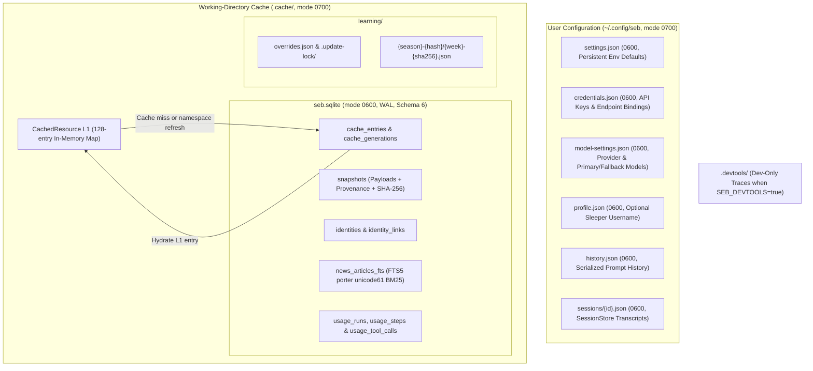

# Storage, cache, and snapshot guide

Seb separates private user configuration and resumable transcripts (`~/.config/seb/`) from working-directory SQLite caches, snapshots, canonical identities, FTS5 news indexes, and metadata-only usage telemetry (`.cache/seb.sqlite`) as well as chronological football learning revisions (`.cache/learning/`).



Run Seb from a consistent working directory when you want CLI invocations to share `.cache/seb.sqlite`, and inspect live storage counts and byte sizes at any time with:

```bash
seb cache status
seb cache status --json
```

Both `.cache/` and newly created `~/.config/seb/` directories apply Unix mode `0700`, and individual SQLite, JSON config, session, history, and learning files are written with mode `0600` (using private temporary files and atomic renames for JSON stores). Never commit `.cache/`, `.devtools/`, or `~/.config/seb/` files to version control.

## User configuration and session files (`~/.config/seb`)

Seb keeps user preferences, credentials, prompt history, and interactive sessions outside SQLite under `~/.config/seb` by default (`SEB_CONFIG_HOME` or `XDG_CONFIG_HOME` selects an alternate root; `SEB_PROFILE_FILE` and `SEB_MODEL_SETTINGS_FILE` override specific file paths):

| File | Schema & size bounds | Stored content |
| --- | --- | --- |
| `settings.json` | Validated via `configuration-registry.ts`, atomic `0600` | Non-secret persistent environment defaults (`NWS_USER_AGENT`, default Sleeper username, model/tracing toggles). |
| `credentials.json` | Schema `1`, `<= 64 KiB` (`<= 16 KiB` per key), atomic `0600` | Provider API keys and canonical base-URL bindings for OpenAI-compatible keys. |
| `model-settings.json` | Schema `1`, `<= 64 KiB` (`<= 200` chars per model ID), atomic `0600` | Saved active provider, primary/fallback model IDs, and optional compatible base URL (no secrets). |
| `profile.json` | Schema `1`, bounded regular-file read, atomic `0600` | Optional default Sleeper username and update timestamp (never stores API keys). |
| `history.json` | Bounded regular-file read, serialized atomic `0600` queue | Interactive prompt history across terminal runs. |
| `sessions/<id>.json` | Bounded regular-file read, atomic `0600` (`SessionStore`) | Resumable interactive conversation transcripts and session metadata (`seb resume <id>`, `seb sessions`). |

Both CLI commands and chat connector processes load saved `~/.config/seb/` defaults at startup via `loadUserEnvironment(process.env, true)` for any unset environment variables, while explicit `process.env` variables always override saved file values.

## SQLite configuration and schema 6

Seb opens `.cache/seb.sqlite` with `WAL` journaling, `synchronous = NORMAL`, enforced `foreign_keys = ON`, `temp_store = MEMORY`, and a `5,000 ms` `busy_timeout`. Numbered transactional migrations upgrade older databases through **schema `6`** (`2`: canonical identities; `3`: provenance checksums; `4`: durable cache namespace generations; `5`: usage tables; `6`: `STRICT` usage tables with row validation, unexpected-index/foreign-key rejection, and a zero-trigger policy so cross-table triggers cannot tamper with telemetry). If `.cache/seb.sqlite` carries a schema version newer than the installed Seb binary, startup halts safely rather than risking downgrade corruption.

| Table | Type | Purpose |
| --- | --- | --- |
| `cache_entries` | Table | Normalized source values, `ETag`/`Last-Modified` validators, schema version, URL, TTLs, and SHA-256 checksums. |
| `cache_generations` | Table | Durable per-namespace generation counters incremented on `/refresh` or `seb cache clear`. |
| `snapshots` | Table | Historical source payloads, JSON Pointer provenance manifests, and dual SHA-256 checksums. |
| `identities` | Table | Canonical NFL franchises and player profiles with SHA-256 checksums (see [identity guide](IDENTITIES.md)). |
| `identity_links` | Table | Provider source-ID mappings with `ON DELETE CASCADE` foreign keys to `identities`. |
| `usage_runs` | `STRICT` table | Agent run lifecycle records, surfaces, timestamps, and bounded error categories. |
| `usage_steps` | `STRICT` table | Logical AI SDK model steps, token classes, latencies, grounding counts, and `ON DELETE CASCADE` to `usage_runs`. |
| `usage_tool_calls` | `STRICT` table | Client and provider tool executions, outcomes, durations, and `ON DELETE CASCADE` to `usage_steps`. |
| `news_articles_fts` | FTS5 virtual table | Porter-stemmed (`porter unicode61`) BM25 full-text index over validated first-class news articles. |

## Usage telemetry

Schema `6` persists local analytics across `usage_runs`, `usage_steps`, and `usage_tool_calls`. Terminal run statuses enforce monotonic precedence (`completed` $\rightarrow$ `failed` $\rightarrow$ `aborted`, or `failed` $\rightarrow$ `aborted`) without altering the initial terminal timestamp so late structured-output validation errors or stream aborts resolve deterministically. Numeric guards cap single token metrics at `10,000,000,000` and durations at `365 days`, canonical ISO 8601 UTC calendar dates are validated before write, and omitted provider metrics remain `NULL` rather than `0`.

> [!IMPORTANT]
> `usage_*` tables store identifiers, timestamps, numeric token/latency metrics, and bounded categories only—never prompts, answers, tool inputs/outputs, raw error strings, API keys, or compatible endpoint URLs. Optional full-content traces live strictly in `.devtools/` (dev-only) or opt-in Judgment OpenTelemetry exports.

## Two-tier cache (`CachedResource`) and freshness periods

Every cached source read passes through `CachedResource`, combining a **128-entry in-memory L1 `Map`** with SQLite L2 (`cache_entries`):

- **L1 & L2 coherence**: Hot repeated lookups (such as schedule, roster, and season player-stat reads across a 40-player batch or combinatorial lineup solve) resolve directly from the 128-entry L1 `Map` without SQLite deserialization overhead, evicting oldest entries when full and clearing immediately on namespace invalidation.
- **Validation & revalidation**: SQLite L2 hits verify matching source URLs, matching client schema versions, and valid SHA-256 checksums (deleting corrupted rows automatically) and recalculate fresh/stale deadlines from `retrievedAt` under current client TTL rules before pruning. Expired fresh windows send conditional `If-None-Match` / `If-Modified-Since` headers when validators exist (`304 Not Modified` renews TTLs without creating a duplicate snapshot).
- **Single-flight refresh & `stale-if-error`**: Concurrent callers in one process share a single upstream refresh per database file and key while keeping independent `AbortSignal` handles (canceling the upstream fetch only if *every* waiter aborts). Refresh failures fall back to un-expired `stale-if-error` entries (flagged in `/sources`), whereas user cancellations never serve stale data.

| Source namespace & value | Fresh period | Additional `stale-if-error` window |
| --- | ---: | ---: |
| Sleeper player catalog | 24 hours | 7 days |
| Sleeper trending & filtered players | 1 minute | 10 minutes |
| Sleeper matchups & transactions | 2 minutes | 1 day |
| Other Sleeper endpoints (state, leagues, rosters, settings) | 5 minutes | 1 hour |
| nflverse schedules (`schedules-v*`) | 6 hours (**15 minutes** during live active-week games awaiting final scores) | 7 days |
| nflverse weekly player stats, PBP defense (`defense-v2-YEAR`), & team stats (`defense-team-v1-YEAR`) | 6 hours | 7 days |
| NWS point metadata | 7 days | 30 days |
| NWS hourly forecasts / active alerts | 10 minutes / 2 minutes | 6 hours / 30 minutes |
| First-class news discovery (`nfl` sitemap, RSS, publisher pages) | 30 seconds – 20 minutes | Up to 1 day (PFF: none; see [data source guide](DATA_SOURCES.md)) |
| Enriched news article metadata / `robots.txt` policies | 1 minute / 24 hours | 7 days / 30 days |

## Request resilience and snapshots

`ResilientFetch` caps upstream calls at **3 attempts** with full-jitter exponential backoff (`Retry-After` honored up to 5 seconds), retrying transient HTTP statuses (`408`, `425`, `429`, `500`, `502`, `503`, `504`), **Cloudflare origin errors (`520`, `521`, `522`, `523`, `524`, `529`)**, and temporary network errors. Five consecutive final failures open a **30-second per-origin circuit breaker** (`15 s` timeouts on Sleeper, NWS, and News; `20 s` on nflverse). Caller cancellation aborts active downloads, gzip expansion, CSV parsing, and retry waits without tripping shared circuit breakers.

Successful fresh network updates write one immutable record to `snapshots` (`<= 32 MiB` payload, `<= 32 MiB` provenance manifest, `512 MiB` default total cap; snapshot write errors never mask a valid live response). Default per-key retention keeps **8** snapshots for Sleeper player catalogs, nflverse schedules, and NWS point metadata, **4** per season key for nflverse weekly player/defense/team statistics, and **8–16** for dynamic Sleeper and NWS forecast/alert keys:

```bash
seb snapshots
seb snapshots --kind nflverse-player-stats --entity player-stats-v1-2025
seb snapshots --id SNAPSHOT_ID --json
```

Inside chat, use `/snapshots` (latest 20) and `/provenance SNAPSHOT_ID` (up to 50 field paths).

## Cache, telemetry, and learning maintenance

Prune or clear caches from the CLI (where `prune` checkpoints WAL and runs `VACUUM`, defaulting to 16 snapshots/key, 180 days, and 512 MiB, while `clear` wipes `cache_entries` and `news_articles_fts` without touching snapshots, identities, or telemetry):

```bash
seb cache prune --max-size-mb 256 --max-age-days 90 --retain 8
seb cache clear
```

Inside interactive chat, invalidate individual source namespaces (both L1 `Map` and SQLite L2) with:

```text
/refresh sleeper
/refresh nflverse
/refresh weather
/refresh news
/refresh all
```

Manage usage telemetry retention separately (`--include-unfinished` removes orphaned `running` rows once all other Seb processes are stopped):

```bash
seb stats prune --retain-days 30
seb stats clear
```

Optional chronological football learning files live separately in `.cache/learning/` (scoring-profile directories, SHA-256 revisions, and `overrides.json`); see [Storage and privacy in the analysis guide](ANALYSIS.md#storage-and-privacy). If `.cache/seb.sqlite` ever fails to open due to disk corruption, check `0700`/`0600` ownership with `seb cache status`, restore from backup if historical snapshots are needed, or move the damaged file aside so Seb initializes a clean database.

<details>
<summary>Legacy pre-1.0 JSON cache cleanup</summary>

Early `0.0.1` builds wrote flat JSON files such as `.cache/sleeper/players-nfl.json`. Current releases use `.cache/seb.sqlite` exclusively and ignore legacy `.cache/**/*.json` cache files (apart from `.cache/learning/`). After verifying `seb cache status` and `seb doctor`, inspect `find .cache -maxdepth 2 -type f -name '*.json'` (excluding `.cache/learning/`) before removing obsolete pre-1.0 files.

</details>
