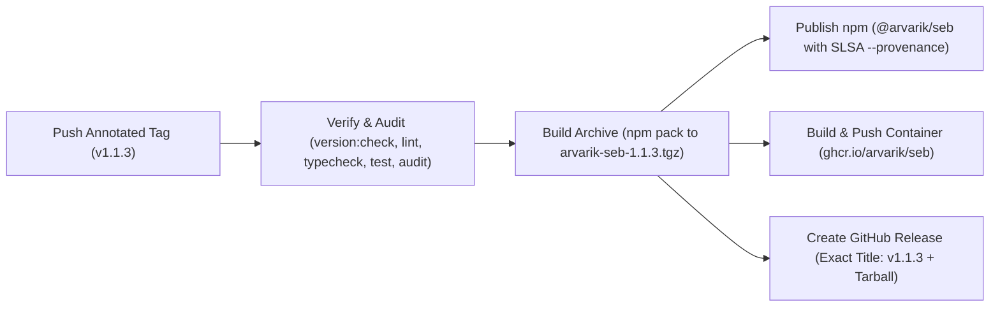

# Versioning and releases

Seb uses [Semantic Versioning](https://semver.org/) with the `MAJOR.MINOR.PATCH` format.

The current version is `1.1.3`.



## Supported public interfaces

Version 1 guarantees compatibility across the documented CLI commands and flags in the [CLI guide](CLI.md), documented interactive slash commands, and connector webhook routes (`/webhooks/slack`, `/webhooks/discord`, `/webhooks/telegram`, `/webhooks/groupme`, and `GET /health`). Structured JSON outputs declare explicit `schemaVersion` integers—downstream integrations should validate `schemaVersion` and ignore newly added object properties.

- **Patch (`X.Y.Z`)**: Backwards-compatible bug fixes, source resilience updates, and documentation improvements.
- **Minor (`X.Y.0`)**: Backwards-compatible commands, connectors, analysis tools, or additive JSON fields.
- **Major (`X.0.0`)**: Breaking CLI flag removals, incompatible JSON schema changes, or removed webhook contracts.

Model prose, default provider model catalogs, numerical projection parameters, built-in newsroom rosters, and terminal layout details may evolve across minor or patch releases without a major bump. Internal TypeScript modules and SQLite tables are not public library APIs; integrate external tooling via CLI `--json` commands.

## Version locations: automated check vs. manual sync

Run `npm run version:check` (`scripts/check-version.mjs`) to verify synchronized release metadata before opening a release PR:

| File | Enforced by `npm run version:check`? | Required content |
| --- | :---: | --- |
| `package.json` | Yes | `"version": "1.1.3"` (read at runtime by `seb --version`) |
| `package-lock.json` | Yes | Matching `"version"` at root and `packages[""].version` |
| `CHANGELOG.md` | Yes | Dated `## [1.1.3] - YYYY-MM-DD` release section |
| `.env.example` | Yes | `NWS_USER_AGENT=seb/1.1.3 ...` example string |
| `docs/VERSIONING.md` | Yes | Exact sentence: ``The current version is `1.1.3`.`` |
| `docs/SETUP.md` | Yes | `NWS_USER_AGENT=seb/1.1.3 ...` setup example |
| `README.md` | Manual check | Top release version badge (`version-1.1.3-...`) |
| `docs/DATA_SOURCES.md` | Manual check | `NWS_USER_AGENT=seb/1.1.3 (you@example.com)` example |

## Release naming invariants

> [!IMPORTANT]
> Git release tags **and** GitHub Release titles must use the exact `vX.Y.Z` format (for example, `v1.1.3`—never `Release v1.1.3` or `1.1.3`). Always push an annotated Git tag and never move or reuse a published tag.

Use a Conventional Commit subject on the release preparation PR:

```text
chore(release): v1.1.3
```

## Prepare and publish a release

1. Branch from up-to-date `main`, consolidate `Unreleased` entries in `CHANGELOG.md` under a dated `[1.1.3]` heading, and bump `package.json` + `package-lock.json` via `npm version 1.1.3 --no-git-tag-version`.
2. Update `.env.example`, `docs/SETUP.md`, `docs/VERSIONING.md`, `docs/DATA_SOURCES.md`, and the `README.md` version badge, then run the full local verification suite:

   ```bash
   npm run check
   npm run test:coverage
   npm audit --omit=dev
   npm run doctor
   npm run contract:sources
   npm run contract:answer
   npm run news:smoke
   npm pack --dry-run
   ```

3. Inspect `npm pack --dry-run` output (and test a clean `--omit=dev` tarball install) to confirm zero credentials, `.cache/`, `.devtools/`, test files, or unrelated artifacts enter the archive.
4. Open the release PR, confirm all required Linux and macOS CI checks pass, squash-merge to `main`, and pull the exact merged commit locally.
5. Create and push the annotated `vX.Y.Z` tag from `main`:

   ```bash
   git tag -a v1.1.3 -m "v1.1.3"
   git push origin v1.1.3
   ```

6. Pushing `v1.1.3` triggers the automated [Release workflow](../.github/workflows/release.yml), which:
   - **Verifies & audits**: Runs `npm run version:check`, `lint`, `typecheck`, `test`, and `npm audit --omit=dev`.
   - **Packages**: Builds the release tarball (`arvarik-seb-1.1.3.tgz`).
   - **Publishes to npm**: Publishes `@arvarik/seb` with cryptographic SLSA provenance (`--provenance`).
   - **Publishes to GHCR**: Builds and pushes multi-metadata container tags to `ghcr.io/arvarik/seb`.
   - **Publishes GitHub Release**: Creates the official GitHub Release titled `v1.1.3` with generated PR release notes and the `.tgz` asset attached.
7. Confirm the published package on npm (`@arvarik/seb`), container tags on GHCR (`ghcr.io/arvarik/seb`), and release page on GitHub.
